<p align="center">
  <picture>
    <source media="(prefers-color-scheme: dark)" srcset=".github/assets/lockup-horizontal-dark.svg">
    
  </picture>
</p>

<p align="center">
  <strong>Handle AI development with confidence.</strong>
</p>

[Harnessforce](https://harnessforce.dev) shows, for every issue, how many times AI agents ran, what
they did, what it cost, and how CI and review went, down to traces, logs and metrics. It works with
Claude Code and Codex. To start in Claude Code, install the plugin from this repository and run
`/harnessforce:setup`; with Codex, use the CLI. Both are in the [Quickstart](#quickstart).

# harnessforce-agent

[](https://github.com/lambda-script/harnessforce-agent/actions/workflows/ci.yml)
[](LICENSE)
[](https://www.npmjs.com/package/@harnessforce/cli)
[](https://www.npmjs.com/package/@harnessforce/semconv)

The agent-side toolkit of Harnessforce: a Claude Code plugin, the `harnessforce` CLI and the Harnessforce
semantic conventions.

Harnessforce links the work of coding agents to the Issues it was done for. This repository holds the
open source parts that run on your machine: they register each Claude Code session with its git
repository, branch and commit, point Claude Code's OpenTelemetry exporter at your Workspace, and give
the agent MCP tools to start and complete a session for an Issue. They send metadata; prompts, responses
and tool input and output are sent only if you choose to send them, and file contents never are.

## Packages

| Package | Description | Distribution |
| --- | --- | --- |
| [`@harnessforce/cli`](packages/cli) | `harnessforce`: connects a machine to a Workspace, launches an agent for an Issue, imports past sessions | npm |
| [`@harnessforce/semconv`](packages/semconv) | `hf.*` attribute names and the JSON Schemas of the ingest API | npm |
| [`harnessforce` plugin](plugins/harnessforce) | Claude Code hooks, MCP server declaration, `record-session` and `propose-improvements` skills, `/harnessforce:setup` and `/harnessforce:tune` | npm (`@harnessforce/claude-code-plugin`), installed through the Claude Code marketplace in this repository |
| `@harnessforce/agent-core` | Logic shared by `harnessforce` and the plugin hook, bundled into both | private |
| `@harnessforce/test-support` | Test helpers | private |

## Quickstart

> The `harnessforce-agent` marketplace in this repository installs the plugin from npm
> (`@harnessforce/claude-code-plugin`, latest version). Internal testers who need a staging or local
> connection use the [local marketplace build](docs/runbooks/local-marketplace.md) instead.

In Claude Code, with Node.js 18 or later installed:

```text
/plugin marketplace add lambda-script/harnessforce-agent
/plugin install harnessforce@harnessforce-agent
/harnessforce:setup
```

`/harnessforce:setup` installs the CLI (`npm install -g @harnessforce/cli`), runs `harnessforce init` to log in
with the browser and pick a Workspace, runs `harnessforce import` for your past sessions, and shows the remaining
workspace steps from `harnessforce status`. Restart Claude Code and run `/harnessforce:setup` again to confirm
that the first event arrived.

With Codex only, set up through the CLI instead: install it with `npm install -g @harnessforce/cli`, run
`harnessforce init` (or `harnessforce init --send-content`) and `harnessforce import`, restart Codex, trust the
harnessforce `SessionStart`, `PostToolUse` and `Stop` hooks in `/hooks`, and check the remaining steps with
`harnessforce status`.

If `/plugin marketplace add` fails with `its source doesn't match its extraKnownMarketplaces entry`, the
environment still registers an earlier local or git `harnessforce-agent` marketplace. Delete that marketplace
in `/plugin`, then add it again, or change its `source` in the `extraKnownMarketplaces` setting to the
repository above.

To work on an Issue, either let the agent use the `record-session` skill, or launch it through the CLI:

```sh
harnessforce run --issue ENG-42 -- claude
```

To look back at your own past sessions, run `/harnessforce:tune`. It runs `harnessforce tune` to count
interventions, loops and MCP server calls by public rules, and shows proposals (a diff or a pull
request draft) once there are at least 10 sessions. It never changes your files; you apply a proposal
yourself.

Organizations can instead distribute a Workspace ingest key through Claude Code managed settings; see
the [plugin README](plugins/harnessforce/README.md#session-registration-hooks).

## Privacy

- **Sent only if you choose:** prompts, responses, and tool inputs and outputs, and only for the categories your
  Workspace stores (`harnessforce init --send-content` or managed settings). Without that, `harnessforce init`
  turns all of them off. File contents are never sent. `harnessforce run` never turns on prompt or body
  logging, and `harnessforce import` sends no content, only session and first prompt IDs, start and end times, repository,
  branch, model, token counts and per-tool call and failure counts.
- **Hashes only:** the config snapshot describes CLAUDE.md files, rules, skills, agents, commands,
  settings and MCP servers by kind, scope, identifier and SHA-256 hash. Their contents, settings
  values and MCP server URLs, headers and environment are never sent. Hook and MCP server hashes
  leave out `env` and `headers` values, `args`, and URL userinfo, queries and fragments.
- **Names and counts only:** the session usage summary counts calls and failures of the skills,
  commands, subagents and MCP servers listed in the session's config snapshot, permission requests
  and compactions. Command arguments, tool inputs and results, error messages and file paths are never
  sent, and names outside the config snapshot are only counted.
- **Keys stay in the keychain:** `harnessforce init` stores keys and tokens only in the OS keychain (on Linux,
  the Secret Service or the in-memory kernel keyring), never in a plain file except the user ingest key in
  Codex's `config.toml`, which Codex can read from nowhere else, and `harnessforce run` never puts them in the agent's environment, arguments or settings.
- **Keys go only where you connected:** the user key and the API token are sent only to the origins
  pinned by `harnessforce init`, and the plugin reads a Workspace key only from the managed settings file, so a
  repository's `.claude/settings.json` cannot redirect them.
- **Fails quietly:** the hooks always exit 0 and give up after 2 seconds (1 second at session end); a
  session is never blocked.
- **Diagrams are not sent to Harnessforce:** the plugin's experimental `diagram` skill downloads mermaid-cli
  and Chromium on first render, and fetches the logos it draws from public icon sites, which see the names of
  the products in a diagram ([details](plugins/harnessforce/README.md#diagram-skill)).

The per-package READMEs describe exactly what each command and hook sends.

## Architecture

```mermaid
---
title: harnessforce-agent architecture
config:
  themeCSS: ".flowchartTitleText { fill: #64748b; } [id*='flowchart-claude-'] { background-color: transparent; } [id*='flowchart-claude-'] p { background-color: transparent; } [id*='flowchart-claude-'] .labelBkg { background-color: transparent; } [id*='flowchart-codex-'] { background-color: transparent; } [id*='flowchart-codex-'] p { background-color: transparent; } [id*='flowchart-codex-'] .labelBkg { background-color: transparent; } [id*='flowchart-cli-'] { background-color: transparent; } [id*='flowchart-cli-'] p { background-color: transparent; } [id*='flowchart-cli-'] .labelBkg { background-color: transparent; } [id*='flowchart-ingest-'] { background-color: transparent; } [id*='flowchart-ingest-'] p { background-color: transparent; } [id*='flowchart-ingest-'] .labelBkg { background-color: transparent; } [id*='flowchart-web-'] { background-color: transparent; } [id*='flowchart-web-'] p { background-color: transparent; } [id*='flowchart-web-'] .labelBkg { background-color: transparent; } @media (prefers-color-scheme: dark) { .edgeLabel .labelBkg, .image-shape .labelBkg { filter: invert(0.94) hue-rotate(180deg); } .image-shape .labelBkg, .image-shape .labelBkg * { background-color: transparent; } .image-shape[id*='flowchart-claude-'] .labelBkg { filter: none; } .image-shape[id*='flowchart-codex-'] .labelBkg { filter: none; } .image-shape[id*='flowchart-cli-'] .labelBkg { filter: none; } .image-shape[id*='flowchart-ingest-'] .labelBkg { filter: none; } .image-shape[id*='flowchart-web-'] .labelBkg { filter: none; } } .label [height], .cluster-label [height] { overflow: visible; } .cluster[id$='-hosted'] .nodeLabel::before { content: none; } .cluster[id$='-machine'] .nodeLabel::before { content: none; } .cluster[id$='-hosted'] rect[x] { transform-box: fill-box; transform-origin: 0 0; transform: translateY(63px) scaleY(0.8818); vector-effect: non-scaling-stroke; } .cluster[id$='-hosted'] .cluster-label [height] { transform: translate(-9.09px, 69px); } .cluster[id$='-machine'] rect[x] { transform-box: fill-box; transform-origin: 0 0; transform: translateY(90px) scaleY(0.893); vector-effect: non-scaling-stroke; } .cluster[id$='-machine'] .cluster-label [height] { transform: translate(-14.28px, 96px); } .flowchartTitleText { transform: translateY(90px); }"
  fontFamily: 'Arimo, Arial, "Liberation Sans", sans-serif'
  theme: neutral
  layout: elk
  elk:
    forceNodeModelOrder: true
    mergeEdges: true
    nodePlacementAlignment: RIGHTDOWN
  flowchart:
    nodeSpacing: 30
    rankSpacing: 50
    wrappingWidth: 160
---
flowchart LR
  %% The hosted service is shown by its public entry points only.
  subgraph machine["<b>Developer's machine</b>"]
    claude@{ img: "", label: "<span style='display:inline-block;min-width:160px'><b>Claude Code</b><br/><span style=font-size:smaller>plugin: hooks, skills</span></span>", pos: "b", w: 72, h: 138, constraint: "on" }
    codex@{ img: "", label: "<span style='display:inline-block;min-width:160px'><b>Codex</b><br/><span style=font-size:smaller>hooks</span></span>", pos: "b", w: 72, h: 138, constraint: "on" }
    cli@{ img: "", label: "<span style='display:inline-block;min-width:160px'><b>harnessforce CLI</b><br/><span style=font-size:smaller>login, import, tune<br/>keys in OS keychain</span></span>", pos: "b", w: 72, h: 165, constraint: "on" }
  end
  subgraph hosted["<b>Harnessforce (hosted)</b>"]
    ingest@{ img: "", label: "<span style='display:inline-block;min-width:160px'><b>Ingest API</b><br/><span style=font-size:smaller>sessions, OTLP</span></span>", pos: "b", w: 72, h: 138, constraint: "on" }
    web@{ img: "", label: "<span style='display:inline-block;min-width:160px'><b>Web</b><br/><span style=font-size:smaller>login, Read API, MCP</span></span>", pos: "b", w: 72, h: 138, constraint: "on" }
  end

  %% secondary calls first, primary flow last
  cli -->|"login, Issues"| web
  cli -->|"import, reports"| ingest
  codex -->|"OTLP, hooks"| ingest
  claude -->|MCP| web
  claude -->|"OTLP, hooks"| ingest

  linkStyle 0,1 stroke:#64748b,stroke-width:1.4px,color:#64748b
  linkStyle 2,3,4 stroke:#2563eb,stroke-width:2.5px,color:#2563eb
  style machine fill:#f5f8ff,stroke:#93b4f5,stroke-width:1.5px
  style hosted fill:#f0fdf4,stroke:#86efac,stroke-width:1.5px
  classDef tile fill:none,stroke:none,color:#1e293b,font-size:18px
  class codex,claude,cli,ingest,web tile
```

<!-- Drawn from .github/assets/architecture.mmd with the logos inlined. Edit the .mmd and render it again with --portable. -->



- **Claude Code** runs the `harnessforce` plugin. Its hooks register each session and its config snapshot
  (`SessionStart`, `UserPromptSubmit`); count the skills, commands, subagents and MCP servers the session
  uses and send one usage summary per session (`PostToolUse`, `PostToolUseFailure`, `UserPromptExpansion`,
  `PermissionRequest`, `PostCompact`, `SessionEnd`); and record the repository and branch the session works
  in, sending them at the end of a turn (`CwdChanged`, `PostToolUse` of `Write` and `Edit`, `Stop`). They use
  the Workspace key from managed settings, or the user key that `harnessforce otel-headers` reads from the
  keychain. The `using-harnessforce`, `record-session` and `propose-improvements` skills tell the agent what
  is recorded, when to start and complete a session for an Issue, and how to write a proposal.
- **Codex** is configured by `harnessforce init`: its `SessionStart`, `PostToolUse` and `Stop` hooks run
  `harnessforce hook` to register sessions and send work locations, and its OpenTelemetry exporter sends
  to the ingest API.
- The **`harnessforce` CLI** logs in with OAuth 2.0 and PKCE, keeps keys and tokens in the OS keychain,
  supplies the ingest key to Claude Code's OpenTelemetry exporter through `otelHeadersHelper`, resolves
  Issues through the Read API, imports past sessions, and sends the counts of `harnessforce tune` as
  analysis reports.
- **Harnessforce** receives all of this through its ingest API, and serves the browser login, the Read API
  and the MCP server at `<connection URL>/mcp`. The plugin only declares the MCP server.
- **`@harnessforce/semconv`** defines what both sides send and accept. `@harnessforce/agent-core` holds the
  logic shared by the CLI and the plugin hook and is bundled into both.

## Development

To develop, see [docs/development.md](docs/development.md).

## Release

`@harnessforce/cli`, `@harnessforce/semconv` and `@harnessforce/claude-code-plugin` are released with
[Changesets](https://github.com/changesets/changesets) and published to npm through trusted
publishing with provenance. See [Releasing](docs/runbooks/releasing.md).

## Community & support

- Questions: [Discussions Q&A](https://github.com/lambda-script/harnessforce-agent/discussions/categories/q-a)
- Feature requests: [Discussions Ideas](https://github.com/lambda-script/harnessforce-agent/discussions/categories/ideas)
- Bugs you can reproduce: [open an issue](https://github.com/lambda-script/harnessforce-agent/issues/new?template=bug_report.yml)
- Billing, your account or your Workspace data: [support@lambdascript.dev](mailto:support@lambdascript.dev)
- Vulnerabilities: [SECURITY.md](SECURITY.md)

Discussions and issues are public; do not post Workspace data, keys, tokens or prompts. See
[SUPPORT.md](SUPPORT.md) for every channel and the response time. To contribute code, read
[Contributing](CONTRIBUTING.md).

## Links

- [Contributing](CONTRIBUTING.md)
- [Support](SUPPORT.md)
- [Security policy](SECURITY.md)
- [Code of Conduct](CODE_OF_CONDUCT.md)
- [Building the local marketplace](docs/runbooks/local-marketplace.md)
- [Releasing](docs/runbooks/releasing.md)

## License

[Apache-2.0](LICENSE)
