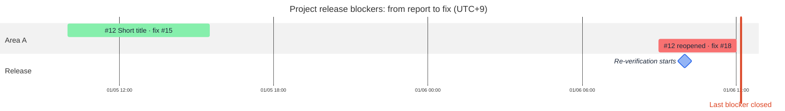

# Gantt charts

Work over time: what was built when, what is in progress, what is planned. Draw it as `gantt` from issue and PR history.

## Contents

- Sources and what to take from them
- Where a bar ends
- Shape of the chart
- Template
- Limits

## Sources and what to take from them

```sh
gh pr list --state all --limit 500 --json number,title,createdAt,mergedAt,closedAt,headRefName,labels,closingIssuesReferences
gh issue list --state all --limit 500 --json number,title,createdAt,closedAt,labels,milestone
gh api repos/<owner>/<repo>/milestones?state=all
gh api repos/<owner>/<repo>/issues/<n>/timeline --paginate   # closed, reopened, cross-referenced, comments
```

| Source | Take |
| --- | --- |
| PRs | a task per PR or per branch topic: start = `createdAt`, end = `mergedAt` (or `closedAt` when not merged) |
| Issues | a task per issue when the chart is about features or bugs: start = `createdAt`, end = see below; open issues are `active` |
| Milestones, release tags | `milestone` tasks on their due date or tag date |
| Dated plan documents | planned tasks after today |
| Labels (`area:*`), branch prefixes (`feature/`, `bugfix/`) | sections |

GitHub Projects fields (iterations, dates) need a token with the `read:project` scope.

A repository with hundreds of PRs does not fit one chart. Pick one question and the label or period that answers it, for example the issues labeled `release-blocker`, or one milestone.

## Where a bar ends

An issue's `closedAt` is when someone closed it, not when the work landed. When the chart answers "when was it fixed", end the bar at the merge of the last PR that fixed it:

- `closedByPullRequestsReferences` names the fixing PRs, including PRs in other repositories. `gh issue view --json` drops the repository, so ask GraphQL for `repository { nameWithOwner }` and mark those tasks (`other-repo#7`).
- An issue closed by hand has no fixing PR in that field. Read its closing comment, which usually names the PRs, and use their `mergedAt`.
- A reopened issue (a `reopened` event in the timeline) gets a second task from the reopening to the next fix, styled `crit` so it stands out.
- An issue whose fix had merged before it was reported (a test run on an old build) is a `milestone` at the report, named for the PR that already fixed it.

Keep the issue's close as a `milestone` when the gap matters, for example a batch closed by hand a day after the fixes.

## Shape of the chart

- `dateFormat YYYY-MM-DD`, an `axisFormat` that fits the span (`%m/%d` for weeks, `%Y-%m` for months), `todayMarker` on for open work. For a span of hours, `dateFormat YYYY-MM-DD HH:mm`, `axisFormat %m/%d %H:%M` and `tickInterval 6hour`.
- Sections by area or by milestone; at most about 30 tasks per chart. Merge PRs that share a branch topic into one task, or chart issues instead of PRs.
- `done` for merged or closed work, `active` for open work, `milestone` for releases and one-off events. Keep `crit` for the exception (a release blocker among other work, a reopened issue): when every task is `crit` it says nothing.
- Task names are short titles with the issue or PR number and, for issues, the fixing PR (`#12 Short title · fix #15`). A `:` in a name ends the name; use `·` or `,` instead.
- Put the source instants above each task as a `%%` comment, so a reviewer can check the bar without converting time zones.
- Name the time zone in the title.

`gantt` takes no layout engine, logos or `classDef`. Color it with `themeVariables` from the palette in [mermaid-layout.md](mermaid-layout.md), which `render.mjs` swaps for the dark theme; the `neutral` theme honors them. `themeCSS` sets the axis font size and the grid lines' color (below).

## Template



## Limits

- A task is one continuous bar: a PR that waited two weeks for review looks like two weeks of work, and an issue bar includes the time before anyone started on it. Say so under the chart when it matters.
- `themeVariables.gridColor` does not reach the grid lines (d3 sets their stroke itself). Lighten them through `themeCSS`: `.grid .tick line { stroke: #cbd5e1; }`; the default black lines run through the labels drawn outside the bars. `render.mjs` appends the frontmatter `themeCSS` to its own, so it applies.
- A `:vert` task draws a vertical line across every section, for one moment that frames the chart (the last blocker closed). Its label sits under the axis; two or three `vert` lines a few hours apart printed their labels over each other. Use one, and keep the other moments as milestones.
- Excluded days (`excludes weekends`) lengthen tasks instead of cutting them.
- Dates come in UTC from GitHub. `dateFormat` carries no offset, so write the wall-clock time of the team's zone (convert before taking the date part) and keep the UTC instant in the comment. `render.mjs` renders in UTC, so a daylight-saving change on the rendering machine cannot move a bar.
