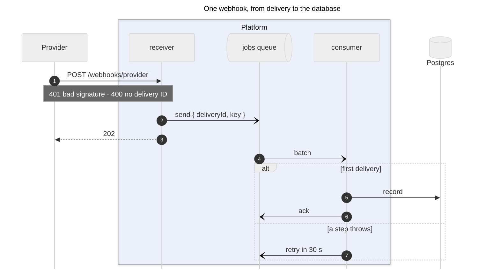

# Sequence diagrams

One request, event or job across components, in time order. Draw it as `sequenceDiagram`.

## Sources and what to take from them

| Source | Take |
| --- | --- |
| Entry points (route handlers, webhook receivers, queue consumers, cron handlers) | the first message and its caller |
| The calls each handler makes (clients, bindings, SQL, queue sends) | messages between participants, sync or async |
| Specs describing the flow | the intended order to compare with the code |
| Error handling on the path | `alt` and `break` branches (see [error-flow.md](error-flow.md)) |

## Template

## Shape of the diagram

- Participants left to right in the order they first appear. Put a participant that only one other calls (a cache, a Durable Object) right next to its caller, so the message does not cross other lifelines.
- `participant id@{ "type": "database" } as Label` for stores, `"queue"` for queues and `"collections"` for object storage; `actor` for people. Use `box` to group the participants of one platform.
- Solid arrows (`->>`) for calls that wait, open arrows (`-)`) for fire-and-forget sends such as queue messages and acks, dashed (`-->>`) for responses.
- `alt` for the outcomes of one step (stored or dropped; first delivery, already processed, or failed), `opt` for a conditional call such as a cache miss, `loop` only when the diagram needs the repetition itself.
- One scenario per diagram; put the happy path first in each `alt`. Rejections that end the request at once (status codes before any work) fit in one `Note` next to the first message better than in branches of their own.
- Color with `box` per platform (GitHub, the runtime, the data stores) and a `rect` around the body of each outcome branch: `rect rgba(34,197,94,0.12)` for success, `rect rgba(239,68,68,0.12)` for a step that throws, `rgba(100,116,139,0.10)` for a drop. `rect` takes `rgb()` and `rgba()` only, like `box`; a hex color drew it gray.
- Set `themeVariables` from the palette so participants, signals and notes match the other diagrams: `actorBkg: "#f8fafc"`, `actorBorder: "#94a3b8"`, `signalColor: "#64748b"`, `noteBkgColor: "#fff7ed"`, `noteBorderColor: "#f59e0b"`, `noteTextColor: "#1e293b"`. The neutral theme's notes are dark gray boxes; amber notes read as remarks. Text that stands on the page (title, `box` names, messages, `loop`/`alt` conditions, participant names) is `#64748b`: `render.mjs --portable` sets it so, since the block keeps its light theme on GitHub's dark page ([embedding.md](embedding.md#rules-for-the-portable-block)).
- `autonumber` so that the text below the diagram can refer to steps. Keep `%%` source comments above each participant and message group, as for the other types; keep the spec's line numbers out of the visible labels.

## Limits (mermaid-cli 12.2.0)

- mermaid-cli fits the PNG into about 800 CSS px of width. A sequence diagram with eight participants is about 2,000 px wide, so its text came out a third of its size. `render.mjs` therefore passes `useMaxWidth: false` for every diagram type it draws; another renderer needs `sequence.useMaxWidth: false` in the frontmatter.
- `box` takes a color only as a name, `rgb()` or `rgba()`: with `box #f5f8ff Label` both the fill and the label disappear. A translucent `rgba(37,99,235,0.07)` tints the box in both themes, since `render.mjs` swaps only hex colors for the dark render.
- No logos, layout engine, `classDef` or `linkStyle`. Participants are plain boxes, cylinders and the other participant types. A participant label renders HTML as text: `` came out as the literal markup, and with a `data:` URI the `;` ends the statement (`got ','`).
- Message labels have no background, so lifelines between the two ends of a message run through its label. A `themeCSS` halo on `.messageText` (`paint-order: stroke`) had no effect, even with `!important`, when tried in the frontmatter before `render.mjs` passed a frontmatter `themeCSS` on (mermaid-layout.md rule 54); it has not been tried since. Keep labels short and order participants as above.
- `mirrorActors: false` drops the second row of participant boxes at the bottom, which only adds height.
