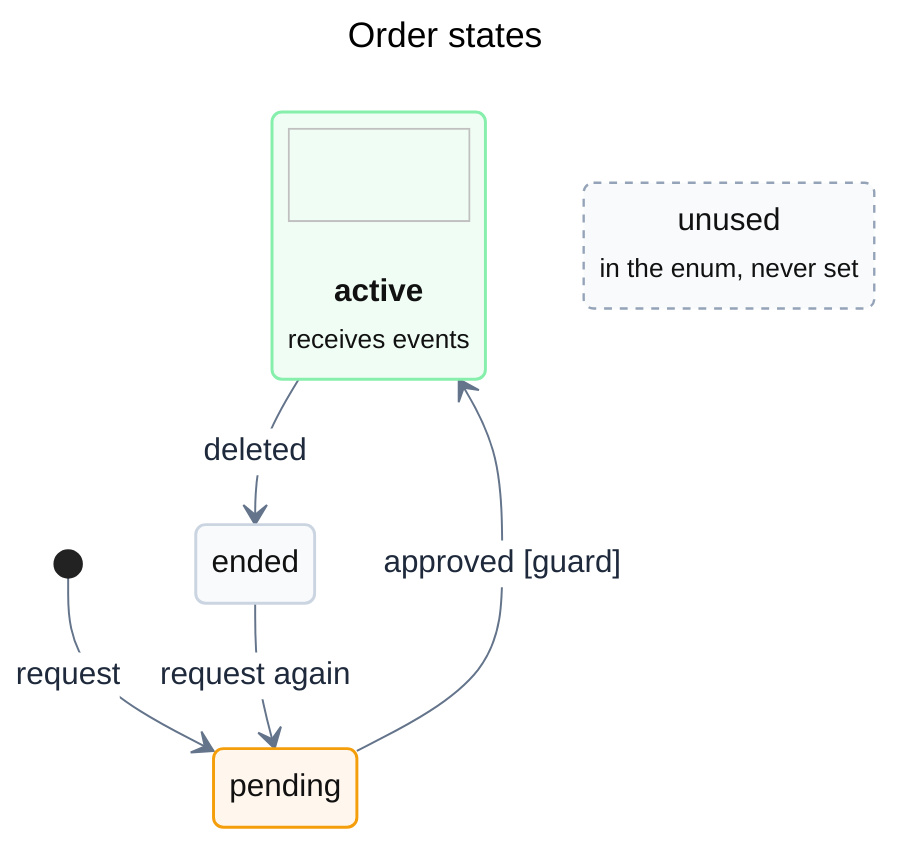

# State diagrams

The states one entity can be in and what moves it between them. Draw it as `stateDiagram-v2`, one entity per diagram.

## Sources and what to take from them

| Source | Take |
| --- | --- |
| Schema enums (Prisma `enum`, SQL `CHECK`, TypeScript union types) | the set of states. An enum gives states, not transitions. |
| Specs with a state table | the meaning of each state; transitions written as "when X, set Y" |
| Code that writes the state field (entities, use cases, handlers, `switch` on the state) | the actual transitions and their triggers; guard conditions |
| Defaults (`@default(...)`, constructor values) | the initial state (`[*] --> state`) |
| States that nothing moves out of | final states (`state --> [*]`) |

Search for every write to the state field (`status:`, `state =`, `update({ ... status })`). A transition that exists only in the spec, or only in the code, is a finding for step 6 of the workflow. So is an enum value that nothing writes: draw it as a state with no transitions, in a dashed class, so the reader sees it is unreachable.

When the entity has no default, every path that creates it sets the state; draw one `[*] -->` edge per path.

## Template

## Shape of the diagram

- `direction TB` for a lifecycle with several ways back (reinstall, retry, reopen). `direction LR` drew a six-state lifecycle with fourteen transitions as a strip three times wider than tall, with small text; `TB` kept the text readable.
- Declare the main path first, then the transitions out of each state in path order, then the transitions that point back (the same ordering idea as mermaid-layout.md rule 11).
- Transition label: the trigger, then a guard in brackets when there is one: `webhook received [signature ok]`. A side effect that does not change the state is a self-transition with `/ effect`. Keep a label to about four words and a description to about five: dagre wraps long ones into three or four lines, and a lifecycle of six states labeled with whole sentences (`install or connect existing installation [verified via OAuth]`) came out with its text half the size of one labeled `install or connect existing`. Name one trigger when several cause the same move (`suspend`, not `suspend event or 15-min reconciliation`), and list the others, the guards left out and the side effects in the Markdown under the diagram.
- Use the palette of mermaid-layout.md (Style) in `classDef`, so the dark render swaps the colors: green for the states the entity works in, orange for waiting, gray for ended. Do not use `#ffffff` as a fill; it is not swapped and the dark theme's light text disappears on it.
- Give each state a Lucide glyph for what it means (an hourglass for waiting, a plug for bound, a pause, an unplugged cable), written as `state ":lucide/<icon>' width='48' height='48'/> <b>name</b> <small>role</small>" as id`. `render.mjs` puts it on the white tile, so the states read apart before their names. The `id : description` form cannot hold it: the inlined data URI contains `:`, `;` and `/`, and the parser fails with `got 'INVALID'`.
- Set `themeVariables.transitionColor` to the secondary edge gray (`#64748b`): transitions take one color, there is no `linkStyle`, and the default black lines outweigh the colored states.
- Put what a state's name does not say in its description, not in a `note`: `revoked : revoked <small>data kept, shown as Disconnected</small>`. The neutral theme draws notes as dark gray boxes that grow tall and pull the layout.
- When several paths reach either of two states depending on one condition, prefer one edge to the usual target and a description line on the other ("also on install if suspended on GitHub") over a `<<choice>>`. dagre puts a choice that back edges point to in the last rank, and every path into it becomes a long line around the diagram.
- A composite state saves edges (one `deleted` from the composite instead of one per inner state), but the inner states lose their `classDef` colors. Use it only when the colors are not needed.

## Limits (mermaid-cli 12.2.0)

- `layout: elk` has no effect: the render is identical to dagre's. The flowchart rules for ELK in mermaid-layout.md do not apply; declaration order and `direction` are the only layout levers.
- `;` ends a statement, also inside a label or a description. `a : x; y` makes states named `y`. Use a comma.
- A `note` on a state that has no transitions fails with "No such shape: undefined". Use a description instead.
- Transitions between states inside different composite states cannot be drawn.
- `classDef` does not apply to start and end states or to states inside composite states.
- `render.mjs` works unchanged: the frontmatter `theme:` switches to dark, the palette colors in `classDef` and `themeVariables` are swapped, and `icon:` specs in state names are embedded like node logos.
- Transitions cannot be colored one by one: a failure path and the main path look the same. Use the states' colors and labels to tell them apart.
